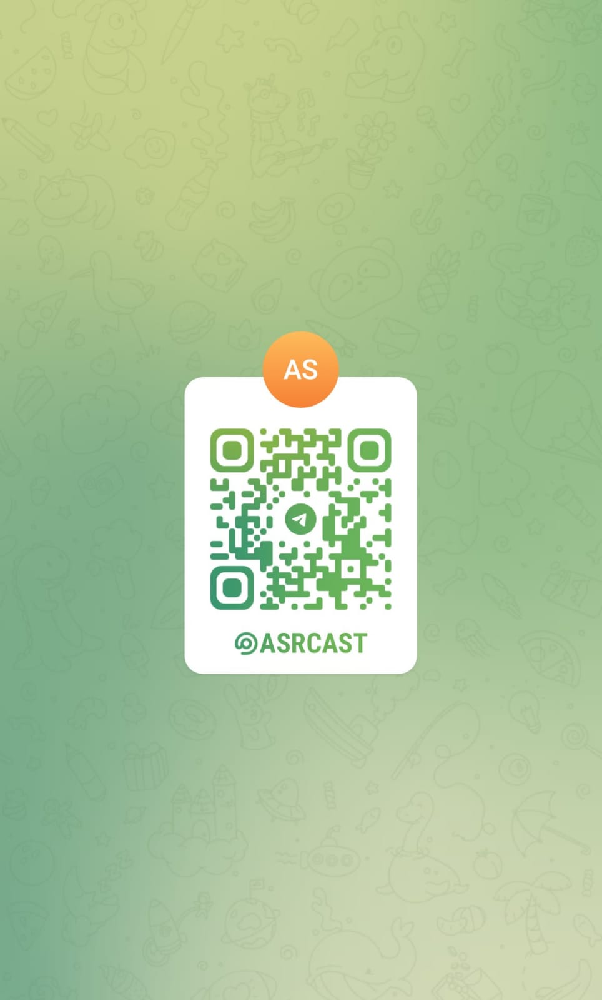

ASRcast
اجعل الحوارات المسموعة معرفة قابلة للبحث والاسترجاع

ASRcast هو مشروع يهدف إلى توثيق الحوارات والمحتوى المعرفي في عصر البودكاست، وتحويل ما يُقال في الحلقات إلى محتوى قابل للفهرسة والبحث والاسترجاع.

الفكرة الأساسية هي أن البودكاست أصبح أحد أهم مصادر المعرفة والنقاش وتبادل الخبرات، لكنه يعاني من مشكلة أساسية: المعلومات تظل محبوسة داخل ساعات طويلة من التسجيلات الصوتية، ويصعب العثور على معلومة محددة أو العودة إلى نقاش سابق دون إعادة الاستماع إلى الحلقة كاملة.

يأتي ASRcast ليعالج هذه المشكلة من خلال توفير بيئة تتيح استكشاف الحوارات والبحث داخلها، والوصول إلى المعلومات والأفكار التي نوقشت فيها بسهولة.

🌐 الموقع: https://asrcast.github.io
📢 قناة تيليجرام: https://t.me/asrcast

🎯 ما الذي يقدمه ASRcast؟

يوفر ASRcast مجموعة من أدوات توثيق الحوارات واستكشافها، بحيث لا يقتصر الوصول إلى المحتوى على عنوان الحلقة أو وصفها، بل يمتد إلى ما قيل بالفعل داخل الحوار.

1. البحث باستخدام Tags

إمكانية استكشاف الحوارات وتصنيفها والوصول إليها باستخدام الوسوم (Tags)، مما يساعد على تجميع الحلقات والحوارات التي تتناول موضوعات متقاربة.

2. البحث حسب التاريخ

إمكانية الوصول إلى الحوارات وفق تاريخ نشرها أو توثيقها، لتسهيل تتبع النقاشات والأحداث والأفكار عبر الزمن.

3. البحث حسب الشخص

البحث عن الحوارات المرتبطة بشخص معين، سواء كان ضيفاً أو مشاركاً في الحوار، واستكشاف ما ناقشه من موضوعات وأفكار.

🔎 محرك البحث واسترجاع المعلومات

لا يقتصر ASRcast على البحث التقليدي، بل يوفر آليات لاسترجاع المعلومات وترتيب النتائج (Ranking)، بما يساعد على الوصول إلى المقاطع والنصوص الأكثر ارتباطاً بموضوع البحث.

ومن آليات الاسترجاع:

فهرس بداية النصوص (Uncommon First-Word Index)

يعتمد هذا الفهرس على معدل التطابق للكلمات السبع الأولى غير الشائعة في النصوص.

الفكرة هي الاستفادة من الكلمات المميزة في بداية العبارات والمقاطع، واستخدامها كمؤشر للوصول إلى النصوص التي تحتوي على صياغات متقاربة.

يساعد ذلك على استرجاع العبارات والمقاطع ذات التطابق اللفظي المرتفع.

فهرس بداية النصوص (Occurrence-Based Index)

طبقة إضافية فوق فهرس التطابق السابق، تعتمد على معدل تواجد الكلمات السبع الأولى غير الشائعة.

بدلاً من الاكتفاء بقياس التطابق، تضيف هذه الطبقة اعتباراً لمدى تواجد الكلمات وظهورها، بما يساعد على تحسين ترتيب نتائج البحث واسترجاع النصوص ذات الصلة.

ترتيب النتائج (Ranking)

تساعد آليات الترتيب على تنظيم النتائج وفق مؤشرات التطابق والتواجد، بحيث يستطيع المستخدم الوصول إلى النتائج الأكثر صلة بدلاً من التعامل مع قائمة طويلة من النصوص دون ترتيب.

📖 قراءة الحوار واستكشاف محتواه

يتيح ASRcast قراءة النصوص المرتبطة بالحوارات، مما يحول الاستماع إلى تجربة معرفية يمكن الرجوع إليها والبحث داخلها.

وتشمل تجربة استكشاف الحوار:

قراءة نص الحوار ومتابعة ما دار بين المشاركين.
استعراض ملخص الحوار للتعرف على أبرز الأفكار والموضوعات.
الوصول إلى المحتوى دون الحاجة إلى الاستماع للتسجيل كاملاً.
مشاهدة تسجيل الحوار من خلال مشغل YouTube المضمّن (YouTube iframe).
مشاهدة الفيديو بجانب النص

من خلال دمج مشغل YouTube باستخدام iframe، يمكن للمستخدم الانتقال من قراءة الحوار إلى مشاهدة التسجيل الأصلي.

وهذا يتيح الجمع بين سهولة البحث النصي والتجربة الأصلية للمحتوى المرئي والمسموع.

💡 لماذا ASRcast؟

لأن المعرفة لا ينبغي أن تضيع داخل ساعات من التسجيلات الصوتية.

البودكاست ليس مجرد محتوى يُستهلك مرة واحدة، بل هو أرشيف متجدد من الأفكار والخبرات والحوارات التي تستحق التوثيق والبحث والعودة إليها.

يسعى ASRcast إلى جعل هذا الأرشيف أكثر قابلية للاستكشاف من خلال:

التوثيق: تحويل الحوارات إلى محتوى نصي يمكن الرجوع إليه.
الاكتشاف: الوصول إلى الحوارات حسب الأشخاص والموضوعات والتاريخ.
البحث: العثور على النصوص والمقاطع باستخدام آليات فهرسة واسترجاع متعددة.
الترتيب: الاستفادة من مؤشرات التطابق والتواجد لتحسين نتائج البحث.
الفهم: قراءة ملخصات الحوارات والتعرف على أهم ما دار فيها.
المشاهدة: العودة إلى التسجيل الأصلي من خلال مشغل YouTube المضمّن.
🚀 ابدأ الاستكشاف

يمكنك زيارة ASRcast واستكشاف الحوارات والمحتوى الموثق:

🌐 ASRcast Website:
https://asrcast.github.io

📢 ASRcast Telegram:
https://t.me/asrcast

ASRcast — From conversations to searchable knowledge.

من الحوارات المسموعة إلى معرفة قابلة للبحث والاسترجاع.
## 📢 انضم إلى قناة ASRcast على Telegram

تابع آخر التحديثات والأخبار المتعلقة بالمشروع.

[https://t.me/asrcast](https://t.me/asrcast)
